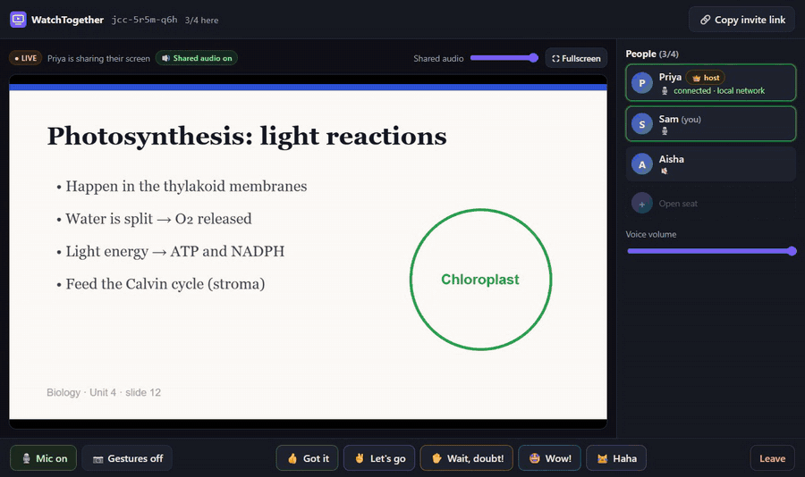
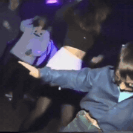
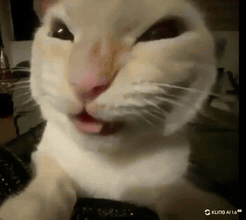
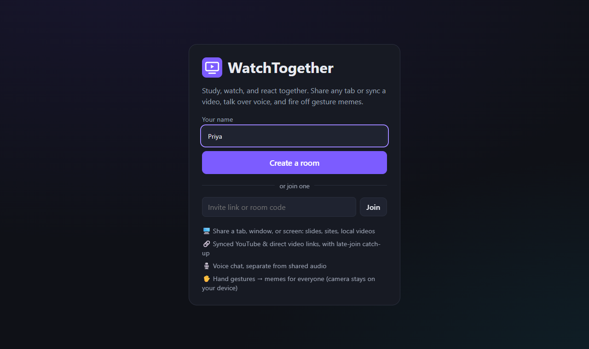
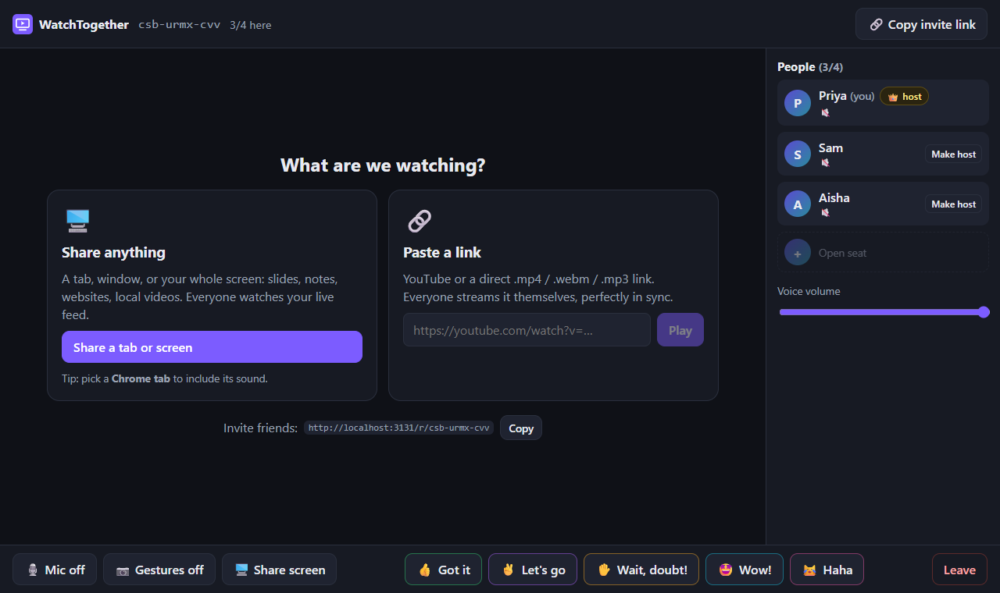

# WatchTogether

**Study, watch, and react together.** Small watch-party rooms (up to 4 people) where the host shares any tab or plays a synced video, everyone talks over voice, and hand gestures pop memes on everyone's screen.

Built first for studying with friends: share your slides or notes, and when someone gets lost they hold up an open palm and a **"Wait, doubt!"** meme stops the room.



<sub>A guest's view: the host shares slides and a friend fires <b>Wait, doubt!</b>. The clip plays with sound for everyone.</sub>

## Features

**🖥️ Share anything**
- The host shares a tab, window, or whole screen over WebRTC: slides, notes, websites, local videos.
- Guests watch the live feed without seek controls.
- The stage shows whether shared audio is included, and tells the host why when it isn't (e.g. window capture never has audio).
- An "Optimize for text / video" switch keeps slides sharp or motion smooth.

**🔗 Paste a link**
- YouTube and direct `.mp4` / `.webm` / `.mp3` links play in sync.
- The host controls play, pause, seek, and speed. Late joiners land at the live position.
- Links that can't play explain why (DRM services, playlists, Google Drive, web pages, …) and offer **Share a tab instead**.

**🎙️ Voice**
- Mesh WebRTC voice chat, kept separate from shared-screen audio, with its own volume control.
- Each person's row shows whether they're connected directly or through a TURN relay.

**✋ Gesture memes**
- Camera is **off by default**. When on, MediaPipe recognizes gestures **on your device**, and only the reaction is sent to the room.
- Hold a gesture for about a second; a cooldown prevents spam. Every reaction also has a button for people without cameras.
- Each reaction plays a short viral meme clip **with sound** for the whole room.

### Meme player

| 👍 **Got it** | ✌️ **Let's go** | ✋ **Wait, doubt!** | 🤩 **Wow!** | 😹 **Haha** |
|:---:|:---:|:---:|:---:|:---:|
|  |  |  |  |  |
| Thumbs-up | Victory | Open palm | Both hands on your chin | Button only |

Mic, camera (gestures), and screen share are separate controls. The host role survives a page refresh and can be handed to someone else.

| Start a room | Pick what to watch |
|---|---|
|  |  |

## Quick start

Requires **Node 20.12+** and a desktop Chromium browser (Chrome or Edge) for screen sharing with audio.

```bash
git clone https://github.com/jafeerahere/watchtogether.git
cd watchtogether
npm install
npm run dev
```

Open http://localhost:5173, enter a name, and create a room. To be a second person, open the invite link in **another tab**; each tab counts as its own person.

For production, a single Node process serves the UI, API, and Socket.IO:

```bash
npm run build
npm start          # http://localhost:3001 (set PORT to change)
```

The first `npm run dev` or `npm run build` also downloads MediaPipe's gesture and face models (~9 MB) into `client/public/mediapipe/`. If that fails, the app loads them from Google's CDN instead.

### Playing with friends on other devices

Browsers only allow the mic, camera, and screen capture over **HTTPS** (or on `localhost`). Friends on other networks may also need a **TURN server** to connect. [docs/DEPLOY.md](docs/DEPLOY.md) covers both step by step:
- mkcert for testing on your Wi-Fi
- a Cloudflare/ngrok tunnel for a quick public link
- Caddy on a server
- coturn with short-lived credentials

## Meme clips

Every reaction plays a short meme clip **with sound** for the whole room; that's the signature feature (previews in the [meme player](#meme-player) above). The clips live in `client/public/memes/`. Swap in your own by replacing a file with the same name; [client/public/memes/README.md](client/public/memes/README.md) has the file names and an ffmpeg one-liner for trimming. If a clip is missing, that reaction falls back to an animated emoji card.

To add or change reactions, edit `shared/reactions.ts`:
- **Captions, colors, durations:** set on each reaction.
- **Gestures:** any built-in MediaPipe gesture (`Thumb_Up`, `Victory`, `Open_Palm`, `Closed_Fist`, `Pointing_Up`, `Thumb_Down`, `ILoveYou`) can be assigned by name.
- **Button-only:** leave out `gesture`.

The two-hands-on-chin pose is a custom geometry check on hand and face landmarks in `client/src/gestures/chinPose.ts`.

## How it works

```
Browser (React + TypeScript)                  Node (Express + Socket.IO)
  room state, sync, signaling  ◄──────────►   in-memory rooms, host rules,
  WebRTC voice + screen (mesh)                 server-clock playback timeline,
  MediaPipe gestures (on-device)               TURN credentials on join
          ▲ media flows peer-to-peer (or via TURN), never through the server
```

- **Synced playback:** the server stores `{playing, position, rate, updatedAt}` stamped with its own clock. Clients estimate their clock offset and compute the live position. Guests correct drift; late joiners jump straight to it.
- **WebRTC:** voice and screen share use separate peer connections per pair, with the "perfect negotiation" pattern, so either side can add a mic later without glare.

More detail in [docs/ARCHITECTURE.md](docs/ARCHITECTURE.md).

## Project layout

```
shared/        protocol types, link checks, reaction definitions (server + client)
server/        rooms.ts (room rules), ice.ts (STUN/TURN), index.ts (HTTP + Socket.IO)
client/src/
  rtc/         PeerMesh.ts (voice + screen WebRTC), media.ts (capture helpers)
  gestures/    detector.ts (hold/cooldown), chinPose.ts (wow pose), engine.ts (MediaPipe)
  components/  Room, ShareStage, LinkStage, GesturePanel, MemeOverlay, Participants, …
tests/         Vitest unit tests
e2e/           Playwright multi-browser tests
docs/          DEPLOY.md · TESTING.md · ARCHITECTURE.md
```

## Testing

```bash
npm test                            # 41 unit tests
npm run build && npm run test:e2e   # multi-person browser tests (uses your installed Chrome)
```

The end-to-end suite runs up to five separate browser sessions on one machine. It covers:
- invite → screen share → voice → memes → synced YouTube and direct links → late join → full room → host refresh
- a relay-only run through a TURN server

**Not yet verified:** two real devices on different networks, real hand gestures in front of a real camera, and Firefox, Safari, and mobile browsers. The full breakdown, with measured sync offsets and a manual two-device checklist, is in [docs/TESTING.md](docs/TESTING.md).

## Status

An early, working prototype. Room state is in memory (one server process, rooms reset on restart), and mesh WebRTC is sized for small rooms of up to 4 people. Contributions and bug reports are welcome.
